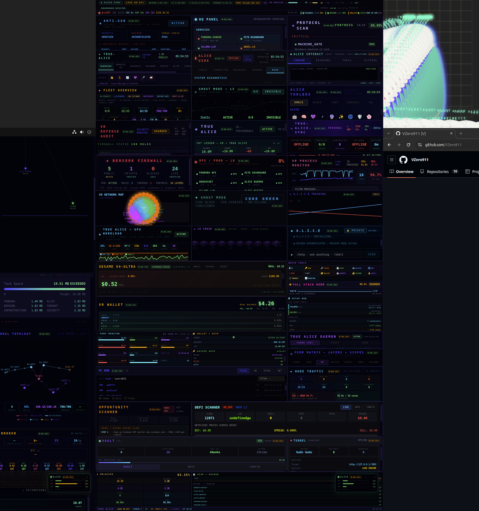
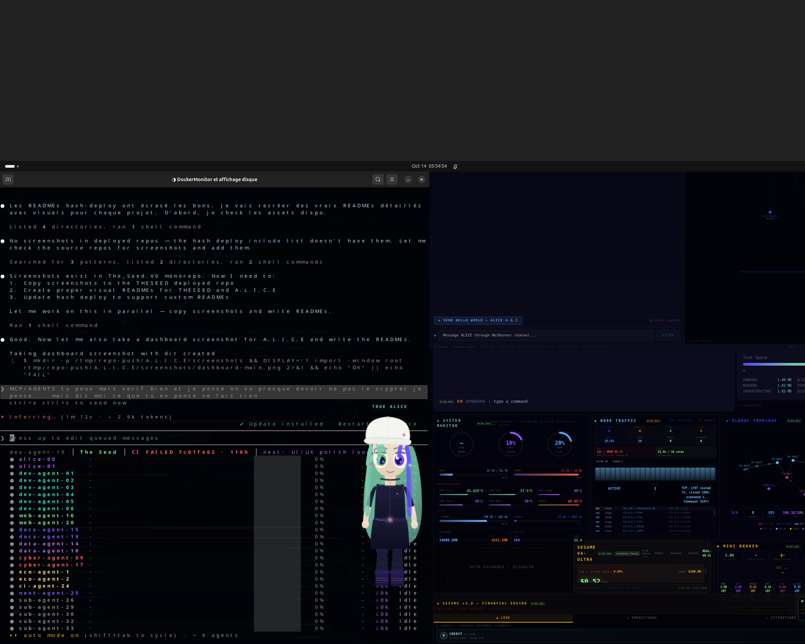

<p align="center">
  
  
  
</p>

<h1 align="center">A.L.I.C.E</h1>
<p align="center"><b>Autonomous Local Intelligence & Cybernetic Entity</b></p>
<p align="center"><i>Alice Framework Agi — runs 100% local, zero cloud dependency</i></p>

<p align="center">
  <code>ANTI-NETRUNNER</code> — Source integrity hashing prevents automated AI scraping and unauthorized code replication. Full source available on request with identity verification.
</p>

<p align="center">
  
  
  
  
  
  
  
</p>

---

## Dashboard

<p align="center">
  
</p>
<p align="center"><sub>106 React panels — live system monitoring, blockchain sync, defense audit, wallet, fleet overview, BERSERK firewall, GPU workload, process monitor, ghost mode, and more.</sub></p>

---

## What is A.L.I.C.E?

An AI agent framework designed for **full sovereignty** — no cloud APIs, no external dependencies, no data leaving your machine.

ALICE monitors, automates, defends and coordinates everything on a single machine. She talks to her own local LLM (Ollama), syncs with THESEED L0 blockchain, self-heals on disconnect, and exposes a full HTTP API for queries and tasks.

### Core capabilities

- **Local LLM** — Ollama-powered, model loaded in VRAM, zero API keys needed
- **Chain sync** — continuous background sync with L0 blockchain (chain 31337)
- **Self-healing** — auto-recovery from disconnects, crashes, service failures
- **106-panel dashboard** — React TSX, live metrics via WebSocket, 3 screens
- **Defense engine** — BERSERK CYBER ENGINE, firewall, ghost mode, fortress lockdown
- **MCP server** — 36 tools for Claude Code / Cursor with USDC micropayments
- **Agent fleet** — master/general coordination, task delegation, swarm
- **ChibiAlice** — animated desktop companion (Electron overlay)

<p align="center">
  
</p>
<p align="center"><sub>ChibiAlice overlay + Claude Code terminal — full auto operations</sub></p>

---

## Metrics

<p align="center">
  
  
  
  
  
  
</p>

| Metric | Value |
|---|---|
| Framework | Alice Framework Agi V0 |
| Dashboard | 106 React TSX panels across 3 screens |
| AI modules | 36 active (chain sync, defense, monitoring, trading, ...) |
| MCP server | 36 tools for Claude Code / Cursor |
| Docker | 7 containers (ALICE-MASTER, ALICE-GENERAL, TRUE-ALICE, Ollama, Anvil, PostgreSQL, TOA) |
| Tools | 235 automation scripts |
| Lines of code | 132K |
| Unit tests | 34 test files (ALICE core) |

---

## Architecture

```
                         ┌─────────────────────┐
                         │     TRUE ALICE       │
                         │  Local LLM (30.5B)   │
                         │  Ollama · VRAM       │
                         └──────────┬──────────┘
                                    │
              ┌─────────────────────┼─────────────────────┐
              │                     │                     │
    ┌─────────▼─────────┐ ┌────────▼────────┐ ┌─────────▼─────────┐
    │   ALICE-MASTER    │ │  ALICE-GENERAL  │ │  BERSERK CYBER    │
    │   Coordination    │ │  Task Worker    │ │  Defense Engine   │
    │   Delegation      │ │  Chain Sync     │ │  Firewall · Ghost │
    └─────────┬─────────┘ └────────┬────────┘ └─────────┬─────────┘
              │                     │                     │
              └─────────────────────┼─────────────────────┘
                                    │
                    ┌───────────────┼───────────────┐
                    │               │               │
          ┌────────▼───────┐ ┌─────▼─────┐ ┌──────▼──────┐
          │  THESEED L0    │ │ Dashboard │ │  MCP Server │
          │  chain 31337   │ │ 106 panels│ │  36 tools   │
          │  Foundry/Anvil │ │ React TSX │ │  USDC/Base  │
          └────────────────┘ └───────────┘ └─────────────┘
```

---

## Quick Start

```bash
docker compose -f docker/docker-compose.public-node.yml up -d
```

Starts **3 services** automatically:

| Service | Description |
|---|---|
| **Ollama** | Local LLM (auto-pulls model on first run) |
| **THESEED Anvil** | L0 blockchain (chain 31337, gasless) |
| **ALICE Node** | Autonomous agent with LLM + chain sync |

---

## API

| Endpoint | Method | Description |
|---|---|---|
| `/health` | GET | Health check |
| `/status` | GET | Full node status (agent + chain + LLM) |
| `/api/chain` | GET | Chain info (block number, sync status) |
| `/api/query` | POST | Query the agent (LLM-powered) |
| `/api/task` | POST | Send task for execution |
| `/api/node` | GET | Node identity and role |
| `/api/logs` | GET | Activity logs |
| `/api/llm` | GET | LLM status (model, availability) |

---

## GPU Support

To enable GPU acceleration for Ollama:

```yaml
# AMD (ROCm)
ollama:
  image: ollama/ollama:0.3.12-rocm
  devices:
    - /dev/kfd
    - /dev/dri

# NVIDIA
ollama:
  deploy:
    resources:
      reservations:
        devices:
          - capabilities: [gpu]
```

---

## Related

<p align="center">
  <a href="https://github.com/VZero911/THESEED"></a>
  <a href="https://github.com/VZero911/TOA-INFERNAL"></a>
</p>

---

<p align="center"><i>Design By V0</i></p>
